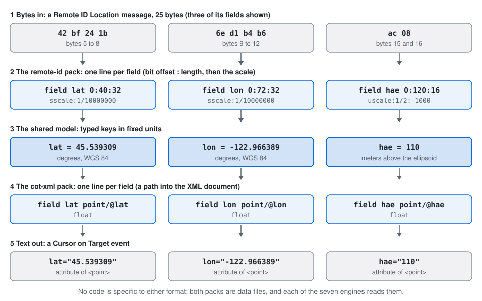

# goat-transformers

[](https://github.com/USAREUR-AF/goat-transformers/actions/workflows/conformance.yml)
[](LICENSE)

goat-transformers converts a message in any supported format to any other
supported format, and each format is a data file that seven independently
written engines read and must agree on, byte for byte. Below, the 25 bytes a
drone broadcasts become a tactical-map event and a ship-instrument message, and
no engine holds code for any of the three formats.

**45 formats · 2,404 message kinds · 3,187 conversion vectors · 7 engines**, counted
by [`tools/repo-stats`](tools/repo-stats).

```console
$ echo 122624160b42bf241b6ed1b4b69808ac0870086b53150e0200 | goat-xf convert --from remote-id --to cot-xml
<event version="2.0" type="a-u-X"><point lat="45.539309" lon="-122.966389" hae="110" ce="9999999" le="9999999"/></event>
$ echo 122624160b42bf241b6ed1b4b69808ac0870086b53150e0200 | goat-xf convert --from remote-id --to nmea2000
01f80142bf241b6ed1b4b6
$ goat-xf convert --from canonical-track-v2 --to asterix-cat062 --set cat062.sac=1 --set cat062.sic=7 < track.json
3e001f9b0d1001075460100000000000000000ffce00110137810101000050
```

Commands 1 and 2: an ASTM F3411 Remote ID Location message becomes a Cursor on Target (CoT) event (`9999999` is CoT's "not known") and NMEA 2000 parameter group 129025.\
Command 3: a track in JSON becomes 31 bytes of ASTERIX Category 062, equal byte for byte to the output of a hand-written encoder ([the table below](#conversions-and-what-carries)).

<picture>
  <source media="(prefers-color-scheme: dark)" srcset="docs/figures/hub-dark.svg">
  
</picture>

## The idea in five sentences

1. A format is a data file, called a **pack**: one line for each field says
   where the value sits in the message and which key of the model it fills.
2. There is one **shared model**: a set of typed keys in fixed units (degrees,
   meters, meters per second, milliseconds since 1970).
3. A conversion decodes the source message to the model and encodes the model
   to the target, so any format converts to any other and N formats need N
   packs, not N×N converters.
4. Seven **engines** (Rust, Go, Python, Java, C++, Erlang, Zig) each read the
   same packs; each is written from the specification and the test messages,
   never from another engine's source, and all seven must produce the same output for
   every test message.
5. Packs written from public sources are in this repository; a pack for a
   format whose specification is not public is kept in a private **overlay**
   that the same engines read.

<picture>
  <source media="(prefers-color-scheme: dark)" srcset="docs/figures/journey-dark.svg">
  
</picture>

## What the repository holds

Counted from the tree by `python3 -I tools/repo-stats`.

| | Count |
|---|---:|
| Formats | 45 |
| Message kinds (one message layout of a format, such as one MAVLink message or one NMEA 2000 parameter group) | 2,404 |
| Typed keys in the shared model, in 43 modules | 35,442 |
| Lists in the shared model (parts of a message that repeat) | 8,698 |
| Conversion vectors (an input message and the exact expected output) | 3,187 |
| Load vectors (a pack that must load, or must be refused with a named error) | 314 |
| Synthetic formats that exercise each rule of the specification | 46 |
| Wire types (an engine's codec for a family of encodings): `xml`, `json`, `geojson`, `protobuf`, `bits` | 5 |
| Engines, each using only its language's standard library | 7 |
| WebAssembly module of the Rust engine, small build, no imports | 346,027 bytes |

| Pack | Format | Wire | Message kinds |
|---|---|---|---:|
| `cot-xml` | Cursor on Target event XML | `xml` | 1 |
| `cot-protobuf` | TAK protocol version 1, the protobuf form of a Cursor on Target event | `protobuf` | 2 |
| `geojson` | GeoJSON Feature (IETF RFC 7946) | `geojson` | 1 |
| `nvg` | NATO Vector Graphics 1.5, point | `xml` | 1 |
| `canonical-track-v2` | Canonical Track v2 of [open-billie](https://github.com/USAREUR-AF/open-billie) | `json` | 1 |
| `sapient` | SAPIENT, BSI Flex 335 v2.0 | `protobuf` | 9 |
| `sapient-v1` | SAPIENT, BSI Flex 335 v1.0 | `protobuf` | 9 |
| `isa` | Integrated Sensor Architecture, IPL 3.7 `Event` | `protobuf` | 1 |
| `isa-message` | Integrated Sensor Architecture, IPL 3.7 message union | `protobuf` | 7 |
| `isa-ipl1` | Integrated Sensor Architecture, IPL 1.6 message union | `protobuf` | 7 |
| `isa-xml` | Integrated Sensor Architecture, IPL 4.7 XML form | `xml` | 7 |
| `uci` | Universal Command and Control Interface (UCI) 2.6 | `xml` | 725 |
| `a-gra` | Autonomy Government Reference Architecture (A-GRA) 6.0a | `xml` | 860 |
| `nmea2000` | NMEA 2000 parameter groups, from the CANboat database | `bits` | 473 |
| `mavlink2` | MAVLink 2, common message set | `bits` | 235 |
| `adsb` | ADS-B on Mode S extended squitter (downlink format 17) | `bits` | 29 |
| `asterix-cat062` | ASTERIX Category 062 system track, written by hand | `bits` | 1 |
| `asterix-cat001` … `asterix-cat247`, `asterix-cat062-full` | 27 ASTERIX categories, 001 to 247, each generated by `tools/gen/asterix2pack.py` from the machine-readable category definitions of `zoranbosnjak/asterix-specs`, every item of the category's first item list | `bits` | 1 each |
| `remote-id` | ASTM F3411 Remote ID (OpenDroneID) | `bits` | 8 |

`asterix-cat062` maps the seven items a track encoder writes and binds them to
the shared track keys; it is the pack to convert a track into.
`asterix-cat062-full` is the generated pack for the same category and reads all
29 items of a record.

Each pack's `pack.md` states what the pack maps and what it leaves unmapped.
[docs/coverage-roadmap.md](docs/coverage-roadmap.md) lists the public formats
that have no pack and what each one needs.

## Conversions, and what carries

Two formats convert to each other exactly the keys that both map. The engine
reports this for every pair of loaded formats (`goat-xf matrix --detail`): which
keys carry, and which the target has no field for. Every row below was run with
the command-line tool on a message from the pack's own vectors.

| From | To | What carries |
|---|---|---|
| Remote ID Location, 25 bytes | CoT event XML | `lat`, `lon`, `hae` |
| MAVLink 2 `GLOBAL_POSITION_INT`, the position message of a drone autopilot | NMEA 2000 parameter group 129025: `01f801d04d6b0830b294f7` | `lat`, `lon` |
| NATO Vector Graphics point, XML | GeoJSON Feature | all 4 keys the source maps |
| CoT event XML | CoT protobuf (TAK protocol version 1) | 13 of the 14 keys the source maps |
| Canonical Track v2, JSON | ASTERIX Category 062, 31 bytes: `3e001f9b0d10…0050` | position, height, velocity east and north, 4 status flags. The caller supplies the two site codes. The bytes equal the ones the hand-written encoder of open-billie writes for the same track |
| Canonical Track v2, JSON | CoT event XML | identity, type, time, position, and course and speed, which the model computes from the velocity vector |

The last row is a rule of the model, not of either pack: `model/track.def`
derives `course` and `speed_ms` from `track.vel_east_ms` and
`track.vel_north_ms`, so every format that carries a velocity vector converts to
every format that carries course and speed.

A value that only the caller knows is supplied with the call:

```console
$ goat-xf convert --from canonical-track-v2 --to asterix-cat062 --set cat062.sac=1 --set cat062.sic=7 < track.json
3e001f9b0d1001075460100000000000000000ffce00110137810101000050
```

## From formats to systems: which options exist

> [!IMPORTANT]
> **Work in progress.** The first version is Built: the record format, the
> query and a fictional example are in this repository. The record format is
> expected to change as records of real systems are written by more than one
> owner ([what is expected to change](docs/system-records.md#expected-to-change)).

Everything above answers a question about formats. People who plan coverage ask
about systems: this radar, that display, the translator on the sensor node. A
**system record** is a short text file that says what one system emits, accepts
or converts, and how well established each claim is. `tools/goat-options` joins
the records with the packs and lists every way data can get from a producing
system to a consuming one.

```console
$ python3 -I tools/goat-options paths --store examples/stores/sketch --from example/radar-1 --to example/edge-display --table
example/radar-1 -> example/edge-display
  conv  status       route                                                 keys
  1     available    asterix-cat048 --[goat-transformers]--> cot-protobuf  1 carried, 143 lost
  1     available    asterix-cat048 --[goat-transformers]--> geojson       1 carried, 143 lost
  1     forthcoming  asterix-cat062 --[goat-transformers]--> cot-protobuf  3 carried, 15 lost
  1     forthcoming  asterix-cat062 --[goat-transformers]--> geojson       3 carried, 15 lost
```

A fictional radar reaches a fictional display four ways. Two are available
today and carry one key. Two wait for an output format the radar's maker has
announced for its next version, and carry three.

- **It lists options and does not choose.** Each path shows its own status
  (`proven`, `available`, `forthcoming`, `unknown`) and the evidence behind it.
  Paths are not ranked, and no path is named as preferred.
- **It is machine-readable first.** The output is JSON; `--table` prints it for
  a person. How to display the answer is left to whoever reads it.
- **Each owner keeps its own records.** A store is a directory of text files.
  The query reads several stores at once and shows which owner said what.
  Records of real systems belong in private stores
  ([docs/private-store.md](docs/private-store.md)); this repository holds
  fictional examples only.
- **A site file says what is on hand.** The same query then answers for one
  place: which of these paths can be used here with the systems present.

The design, the record format and a worked example are in
[docs/system-records.md](docs/system-records.md).

## Add a format without writing code

This is the complete pack for a NATO Vector Graphics point,
[`packs/nvg/pack.def`](packs/nvg/pack.def):

```
format   nvg                                # the name used with --from and --to
version  0.1.0
distribution public                         # public, or controlled (overlay only)
source  "NATO Vector Graphics 1.5 XSD (NATO ACT, public)"   # the document it was written from
wire     xml                                # the codec: xml, json, geojson, protobuf or bits
root     nvg                                # the root element
field   lon       point/@x        float     # model key, place in the message, transform
field   lat       point/@y        float
field   callsign  point/@label    string
field   type      point/@symbol   string
```

and this is the message it describes:

```xml
<nvg><point x="11.2" y="48.137" label="ALPHA" symbol="app6a:SFGPUCI----D"/></nvg>
```

With that file in `packs/nvg/`, all seven engines convert NVG points to and
from every other loaded format:

```console
$ echo '<nvg><point x="11.2" y="48.137" label="ALPHA" symbol="app6a:SFGPUCI----D"/></nvg>' | goat-xf convert --from nvg --to geojson
{"type":"Feature","geometry":{"type":"Point","coordinates":[11.2,48.137]},"properties":{"type":"app6a:SFGPUCI----D","callsign":"ALPHA"}}
```

The pack language also states binary layouts by bit range, scale factors,
several message kinds chosen by values in the message, constants, defaults,
value tables, repeating groups, and fields whose presence or length the message
itself states ([spec/engine-spec.md](spec/engine-spec.md)). A pack for a large
message catalog is generated from the catalog's own machine-readable definition
(a protobuf file, an XML schema, the CANboat database, the MAVLink message
definitions) by the generators in [`tools/gen/`](tools/gen).

## Why open

- **One definition per format.** A gap or an error in a pack is corrected in
  one file, and every user of that format, in every language, has the
  correction at the next update.
- **The owner of a format can keep its pack.** A pack is a text file that
  mirrors the format's specification, so the organization that writes the
  specification (a vendor, a standards body, a program office) can maintain the
  pack directly by pull request. The people who know the format keep it
  correct, and the users of the format do not each re-implement it.
- **Nothing about a format is inside a product.** The field positions, units
  and rules are readable text with a named source. The engines are Apache-2.0
  and use only standard libraries.
- **A new format reaches everything at once.** One pack makes a format
  convertible to and from every format already present, in all seven
  languages, in the browser and in a static binary.

## Who checks it

| Check | What it does |
|---|---|
| Seven independent engines | Each engine is written from [`spec/`](spec) and the vectors, never from another engine's source, so a defect in one engine shows as a difference from the other six |
| Conversion vectors | Every engine runs every vector and must reproduce the expected output byte for byte. Expected bytes are derived independently of the engines: from the format's specification, its reference implementation, or a generator that computes them itself |
| Load vectors | A pack that breaks a rule must be refused by every engine with the same named error |
| CI | [`.github/workflows/conformance.yml`](.github/workflows/conformance.yml) builds each engine and runs every vector on it, on every change; a change merges when every check passes |
| Boundary gate | `python3 -I tools/boundary-gate` reads every file and refuses a pack with no public marking or no named source, and file types that could hold a restricted document ([docs/boundary.md](docs/boundary.md)) |

## Use it

Try the command-line tool. This needs a Rust toolchain and nothing else.

```bash
git clone https://github.com/USAREUR-AF/goat-transformers
cd goat-transformers/engines/rust
cargo build --release
echo 122624160b42bf241b6ed1b4b69808ac0870086b53150e0200 \
  | ./target/release/goat-xf convert --from remote-id --to cot-xml
./target/release/goat-xf list-formats
```

Embed an engine in your own language. Each is a library with no dependency
beyond the standard library; `engines/<language>` holds it and
[CONTRIBUTING.md](CONTRIBUTING.md) lists the build and test command of each.

| Your code is in | Use |
|---|---|
| Rust, Go, Python, Java, C++, Erlang, Zig | the native engine in `engines/rust`, `go`, `python`, `java`, `cpp`, `erlang`, `zig` |
| JavaScript or TypeScript, in Node or a browser | the WebAssembly module and its wrapper in [`bindings/wasm`](bindings/README.md) |
| C, or any language that can call C (C#, Swift, and others) | the C library in [`bindings/c`](bindings/README.md) |

In Python, for example:

```python
from goat_transformers import Engine          # PYTHONPATH=engines/python/src

engine = Engine.from_dir("packs", "model")    # the packs directory, the model directory
engine.convert("remote-id", "cot-xml", "122624160b42bf241b6ed1b4b69808ac0870086b53150e0200")
```

<!-- MAINTAINER: when docs/using.md is merged, add here: "[docs/using.md](docs/using.md) states how to install and call the library from each language." -->

goat-transformers is pre-1.0: the pack language and the engine interfaces can
still change.

## Make exactly what you need

A pack loads on its own, so a deployment carries only the formats it uses.
`--packs-only` loads the named packs and leaves the rest unread; every engine's
command-line tool has it, and a library caller has the same choice.

```bash
goat-xf convert --from remote-id --to cot-xml --packs-only remote-id,cot-xml < message.hex
```

`tools/goat-pkg plan` takes the formats, the language, the runtime, the
operating system and the processor architecture, and prints the smallest
package: the engine, only the named packs, the wire types they use, the build
command, and what carries between the named formats. Part of its output:

```console
$ tools/goat-pkg plan --formats remote-id,cot-xml --language rust --runtime wasm
engine:      engines/rust
packs:       remote-id, cot-xml   (only these)
wires used:  bits, xml   (a minimal engine build can exclude the rest)
build:       cargo build --release --lib --target wasm32-unknown-unknown
```

The Rust and Go engines build to one static binary with no shared library, and
to WebAssembly; the Java engine is a jar
([docs/package-configurator.md](docs/package-configurator.md)).

## Private formats

A pack for a format whose specification is not public is kept in a private
overlay repository, which names the commit of this repository it builds with
and adds its own packs; the engines read both unchanged, and such a format
converts to and from every public format through the shared model. Every pack
is marked `distribution public` or `distribution controlled`, and an engine
started with `--max-distribution public` loads nothing marked `controlled`.

[goat-transformers-overlay-example](https://github.com/USAREUR-AF/goat-transformers-overlay-example)
is a worked overlay with fictional content, [docs/boundary.md](docs/boundary.md)
states the rules and the checks, and
[docs/coverage-roadmap.md](docs/coverage-roadmap.md#formats-whose-specification-is-not-public)
states how such formats are covered.

## Working with an AI assistant

[AGENTS.md](AGENTS.md) gives an assistant the layout, the rules and the
commands of this repository. [`.claude/skills/`](.claude/skills) holds
step-by-step procedures (add a format, generate packs from a schema, convert a
message, build a minimal package, write an overlay, review a pack, extend the
pack language) and [`.claude/agents/`](.claude/agents) holds the roles the
project uses when several assistants work at once.

## Layout

```
spec/        the engine specification, the shared model, the vector format
model/       the shared model's modules, one file each
packs/       one directory per format: pack.def, pack.md, vectors/
engines/     one directory per language
bindings/    the Rust engine as a C library and as a WebAssembly module
examples/    fictional system records and a site file for tools/goat-options
tools/       goat-pkg, goat-options, boundary-gate, repo-stats, and the pack generators in gen/
docs/        design, language guidance, decision records, format coverage, the package planner
```

## Contributing, security, license

[CONTRIBUTING.md](CONTRIBUTING.md) states how to run the conformance suite and
how to add a pack, a wire type or an engine. The design is
[docs/design.md](docs/design.md). Report a vulnerability through
[SECURITY.md](SECURITY.md).

Apache License 2.0 ([LICENSE](LICENSE)). Portions written by U.S. Federal
government employees within the scope of their employment are not subject to
copyright in the United States ([INTENT.md](INTENT.md)). [NOTICE](NOTICE) lists
the third-party sources the packs were written from.
